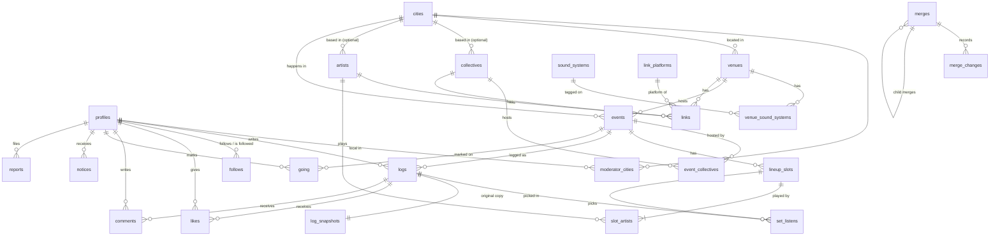

# Data model (v1)

The tables, relationships, constraints, and indexes for v1, and which of them are hard to
change once real data exists. Product rules are in `SPEC.md`. The decisions behind this
shape are in ADRs 0008 to 0016. Once migrations exist, they are the source of truth
and this file describes them.

Rules for changing the schema are in `.claude/rules/database.md`.

## Conventions

- **Keys.** Every table has a UUID primary key named `id`, except join tables (composite
  key), `cities` (GeoNames ID), `link_platforms` (a text ID such as `instagram`), and
  `event_redirects` (`from_short_id`). `profiles.id` is the same value as `auth.users.id`.
- **Short IDs.** Pages that can be shared (venues, DJs, collectives, events, logs) also have
  a `short_id`: a short random string, unique per table, used only in URLs. UUIDs never
  appear in a URL. Eight characters from `23456789abcdefghjkmnpqrstuvwxyz`: digits and
  lowercase letters without `0`, `1`, `i`, `l`, and `o`, which read alike. That is 31^8,
  about 853 billion values. A collision is refused by the unique constraint and retried
  with a new value.
- **Missing values** are `NULL`. Optional text columns refuse empty or whitespace-only text,
  so `''` is never stored. The app turns blank input into `NULL`.
- **Fixed lists** the code switches on are Postgres enums (listed in [Enums](#enums)). Lists
  that carry data or that admins extend are lookup tables (`sound_systems`,
  `link_platforms`).
- **States** that can overlap and need a "when" are nullable timestamps: `hidden_at`,
  `edited_at`, `deleted_at`. States that could gain more values are enums: `visibility`,
  `account_status`, `status`.
- **Ratings** are `smallint` from 1 to 10: half-stars times two, so 7 is 3.5 stars. Every
  rating column checks 1 to 10. A skipped rating is `NULL`, never 0.
- **Times** are `timestamptz`. Event dates are `date`: the night it started, read in the
  event city's timezone. "Today" for any rule means today in the event's city.
- **Delete behaviour** is listed per reference. "Cascade" deletes the child row. "Set null"
  keeps it and empties the reference.
- **Merged rows** stay in their table with `merged_into_id` set (ADR 0009). Unique rules
  ignore them, and triggers refuse any new row that points at one. Merges ship in
  Milestone 10 (ADR 0014), but the `merged_into_id` columns exist from the start and stay
  empty until then, because the event identity indexes and the co-host copies include
  them.
- **Milestone 10** marks the tables, columns, and enum values that ship with merges and
  undo (ADR 0014). v1 migrations leave them out.

### Roles

`profiles.role` is `user`, `moderator`, or `admin`. The app shows `moderator` as "Local"
(for example "Berlin local"). The label lives in the app, not the database. Admins can do
everything moderators can.

### URLs

| Page | URL |
|---|---|
| Venue | `peerreview.club/venues/<short_id>/<name-city>` |
| DJ | `peerreview.club/djs/<short_id>/<name>` |
| Collective | `peerreview.club/collectives/<short_id>/<name>` |
| Event | `peerreview.club/events/<short_id>/<name-date>` |
| Log | `peerreview.club/logs/<short_id>` |
| Profile | `peerreview.club/@<handle>` |

The `short_id` finds the row. The name part is built from the current name and is not
stored; a missing or outdated one redirects to the current URL. A merged row's URL
redirects through `merged_into_id`. An event deleted after a log move redirects through
`event_redirects`. Log URLs never include the handle, so a handle change does not break
shared log links. An old handle does not redirect.

## Relationships

Left out for readability: `creations`, `catalog_edits`, `reports`, and `notices` point at
several kinds of rows (listed in their sections), and every catalog table points at itself
through `merged_into_id`.

## Enums

Each enum lists its v1 values. A value with "(only value)" exists so a later feature adds a
value instead of changing a column's type.

| Enum | Values | Used by | Why it is an enum |
|---|---|---|---|
| `role` | `user`, `moderator`, `admin` | `profiles.role` | ADR 0009 |
| `account_status` | `active`, `banned` | `profiles.account_status` | A temporary suspension is the next likely value |
| `log_visibility` | `public`, `private` | `logs.visibility` | Followers-only is on the "Not in v1" list |
| `going_visibility` | `private` (only value) | `going.visibility` | ADR 0007 names mutual-follow visibility as the start of a social version |
| `follow_status` | `active` (only value) | `follows.status` | Followers-only usually brings follow requests (`pending`) |
| `notice_kind` | `going_prompt` | `notices.kind` | SPEC section 8. `event_merge` and `merge_undone` are added in Milestone 10 (ADR 0014) |
| `notice_action` | `log_it`, `didnt_go`, `dismissed` | `notices.action` | `keep` and `switch` are added in Milestone 10 |
| `report_reason` | `duplicate`, `didnt_play`, `wrong_info`, `spam`, `abusive`, `other` | `reports.reason` | |
| `report_status` | `open`, `actioned`, `dismissed` | `reports.status` | |
| `catalog_type` | `venue`, `artist`, `collective`, `event`, `lineup_slot` | `merges`, `catalog_edits` | `lineup_slot` for slot changes (ADR 0013). Never a merge type |
| `merge_change_type` | See [merge_changes](#merge_changes) | `merge_changes.change_type` | Milestone 10 |

## Tables

### Accounts

#### profiles

One row per account, created when the user picks a handle after first sign-in.

| Field | Type | Notes |
|---|---|---|
| `id` | uuid | Same as `auth.users.id`. Deleting the auth user cascades here |
| `handle` | text | Required. Unique ignoring case. Letters, digits, `_`, `.`, 2 to 30 characters. Can change |
| `display_name` | text | Optional, up to 50 characters |
| `role` | `role` | Default `user`. Only admins change it |
| `account_status` | `account_status` | Default `active`. Only admins change it |
| `account_status_at` | timestamptz | When the status last changed |
| `created_at` | timestamptz | |

No email column, and no other table has one.

#### moderator_cities

The cities on a moderator's profile ("Berlin local"). Stored, not enforced in v1.

| Field | Type | Notes |
|---|---|---|
| `profile_id` | uuid | References `profiles`. Cascade |
| `city_id` | integer | References `cities` |

Primary key `(profile_id, city_id)`.

### Catalog

#### cities

Seeded once from GeoNames (Milestone 2). Read-only for users.

| Field | Type | Notes |
|---|---|---|
| `id` | integer | The GeoNames ID |
| `name`, `ascii_name` | text | GeoNames main name and its ASCII form |
| `country_code` | text | ISO 3166 two-letter code |
| `admin1_name` | text | State or region, for "Portland, Oregon" vs "Portland, Maine" |
| `population` | integer | Sorts autocomplete |
| `timezone` | text | IANA name, for example `Europe/Berlin`. Drives every date rule |

Deferred to Milestone 2: which GeoNames file, leaving out district entries, and a
`city_names` table with English and local names so "Cologne" and "Köln" both match.

#### sound_systems

Seeded lookup: Funktion-One, Void Acoustics, L-Acoustics, d&b audiotechnik, Danley, Martin
Audio, Other. Fields: `id`, `name` (unique), `sort_order`.

#### link_platforms

Seeded lookup of link types and the domains each accepts.

| Field | Type | Notes |
|---|---|---|
| `id` | text | `instagram`, `resident_advisor`, `soundcloud`, `bandcamp`, `website` |
| `label` | text | Shown in forms |
| `allowed_hosts` | text[] | For example `{instagram.com, www.instagram.com}`. Empty means any http or https URL (`website`) |
| `for_venues`, `for_artists`, `for_collectives` | boolean | Which forms show it. Venues: Instagram, Resident Advisor, website |
| `sort_order` | smallint | |

A new platform (Discogs, Mixcloud) is a new row, not a column on three tables.

#### venues

| Field | Type | Notes |
|---|---|---|
| `id` | uuid | |
| `short_id` | text | Unique |
| `name` | text | Required |
| `city_id` | integer | Required. References `cities` |
| `used_by_others_at` | timestamptz | Set by a trigger the first time another user picks the venue. Ends the creator's edit rights |
| `merged_into_id` | uuid | References `venues` |
| `hidden_at` | timestamptz | Admin only |
| `created_at`, `updated_at` | timestamptz | |

Unique on `(id, city_id)`, so events can reference both together.

#### venue_sound_systems

`venue_id` (cascade) and `sound_system_id`. Primary key on both.

#### artists

One row per DJ or live act. "DJs" in the UI.

| Field | Type | Notes |
|---|---|---|
| `id` | uuid | |
| `short_id` | text | Unique |
| `name` | text | Required. Refused when it contains "b2b" (any case) |
| `city_id` | integer | Optional home city. References `cities`. Tells apart DJs with the same name (ADR 0011) |
| `used_by_others_at` | timestamptz | As on venues |
| `merged_into_id` | uuid | References `artists` |
| `hidden_at` | timestamptz | |
| `created_at`, `updated_at` | timestamptz | |

Among DJs not merged, no two share a name and a city, a missing city counting as equal.
One unique index on `(lower(btrim(name)), city_id)` with `NULLS NOT DISTINCT`, limited to
rows not merged (checked). A second "DJ Rush" needs a city when the first has none, and
renaming a DJ or changing their city into a taken pair is refused. The form requires the
city in exactly that case, so it and the index agree.

#### collectives

| Field | Type | Notes |
|---|---|---|
| `id` | uuid | |
| `short_id` | text | Unique |
| `name` | text | Required |
| `city_id` | integer | Optional home city. Display and search only, never used to match events |
| `used_by_others_at` | timestamptz | As on venues |
| `merged_into_id` | uuid | References `collectives` |
| `hidden_at` | timestamptz | |
| `created_at`, `updated_at` | timestamptz | |

#### links

| Field | Type | Notes |
|---|---|---|
| `id` | uuid | |
| `venue_id`, `artist_id`, `collective_id` | uuid | Exactly one is set (check). Cascade |
| `platform_id` | text | References `link_platforms` |
| `url` | text | Host must be in the platform's `allowed_hosts` (trigger) |

One link per platform per entry: unique on each owner column plus `platform_id`.

### Events and lineups

#### events

One night. See [Event identity](#event-identity).

| Field | Type | Notes |
|---|---|---|
| `id` | uuid | |
| `short_id` | text | Unique |
| `date` | date | Required. The night it started |
| `city_id` | integer | Required. References `cities` |
| `venue_id` | uuid | Optional. References `venues` |
| `name` | text | Optional. The official name from the poster, "Halloween" (ADR 0016) |
| `name_locked_at` | timestamptz | Set by a trigger when a user other than the name's setter logs the night or marks Going on it. Cleared when the name changes. Ends the setter's edit right |
| `merged_into_id` | uuid | References `events` |
| `hidden_at` | timestamptz | |
| `created_at`, `updated_at` | timestamptz | |
| `name_key` | text | Generated: the name lowercased and trimmed, or `''` when there is no name. Copied to `event_collectives` |
| `has_venue`, `is_merged` | boolean | Generated from `venue_id` and `merged_into_id`. Copied to `event_collectives` |

Constraints:
- Per venue and date, among events not merged: one unnamed event, and named events with
  distinct names, ignoring case. One unique index on `(venue_id, date, lower(name))` with
  `NULLS NOT DISTINCT`, limited to rows with a venue and not merged. `NULLS NOT DISTINCT`
  makes two missing names count as equal; without it, Postgres treats them as different and
  lets both in (checked).
- `(venue_id, city_id)` references `venues (id, city_id)`, updates cascading. A venue
  night's city always matches its venue, and a corrected venue city moves its events.
- Unique on `(id, date, name_key, has_venue, is_merged)` for `event_collectives`, and on
  `(id, date)` for `logs`.
- Every event has a venue, at least one collective, or both. This spans two tables, so the
  function that creates events enforces it, and a trigger re-checks it when the last
  collective is removed from a no-venue event.
- Any user logging the event or marking Going on it can fill in `venue_id` or `name` when
  empty, and add a collective. The name's setter can change or clear `name` until
  `name_locked_at` (ADR 0016). Only moderators and admins change or remove any other value
  once set, and the name after that.
- The name's setter is the `edited_by` of the event's latest `catalog_edits` row for
  `name`, or the event's `creations` row when the name was set with the event. It is never
  stored on `events`, because a public row must not show who did what. The lock trigger
  runs on log and Going inserts and on "Change night" moves into the event, and skips the
  setter's own rows.
- Filling in `venue_id` on a no-venue event can clash: the venue unique index refuses a
  second unnamed (or same-name) night at that venue on that date, and the `(venue_id,
  city_id)` reference refuses a venue in another city. Adding a co-host to a no-venue event
  can clash on the `event_collectives` index. The function that fills fields turns each
  refusal into the form message and the "Report as the same night" choice (SPEC section 3).

#### event_collectives

The collectives hosting an event. Co-hosts are equal: the event shows on each of their
pages.

| Field | Type | Notes |
|---|---|---|
| `event_id` | uuid | |
| `collective_id` | uuid | References `collectives` |
| `event_date`, `name_key`, `has_venue`, `is_merged` | | Copies of the event's values. Never null |

Primary key `(event_id, collective_id)`.

Why the copies: the collective rule needs the collective, date, and name together, and a
unique index only sees one table. Constraints:
- `(event_id, event_date, name_key, has_venue, is_merged)` references the same five values
  on `events`, with updates and deletes cascading. A wrong copy is refused, and renaming,
  redating, or merging an event updates its copies (checked). The copies are never null
  because Postgres skips this check when any referenced value is null (checked).
- Per collective and date, for events with no venue and not merged: one unnamed event, and
  named events with distinct names, counting every co-host. Unique index on
  `(collective_id, event_date, name_key)` where `has_venue` and `is_merged` are false.

#### event_redirects

| Field | Type | Notes |
|---|---|---|
| `from_short_id` | text | Primary key. The deleted event's `short_id` |
| `to_event_id` | uuid | References `events`. Cascade |
| `created_at` | timestamptz | |

Written when a log move leaves an event with no logs and no Going markers and the event is
deleted. When the target event is itself later deleted the same way, existing redirects to
it are updated, so redirects never chain.

#### lineup_slots

One set. Holds one artist, or several for a b2b set. Whether a slot is b2b is worked out
from its artist count, never stored.

| Field | Type | Notes |
|---|---|---|
| `id` | uuid | |
| `event_id` | uuid | References `events`. Cascade. Updates cascade (merges) |
| `removed_at` | timestamptz | Set when the slot is removed. The row and its picks stay so the removal can be reverted (ADR 0013) |
| `created_at` | timestamptz | |

Unique on `(id, event_id)` for `set_listens`. Among slots not removed, the same set of
artists appears at most once per event (enforced by the functions that add, change, and
revert slots and merge events). Who added the slot is in `creations`.

A slot never gets a different artist (ADR 0013). The lineup functions allow only:
- Adding an artist ("b2b with") until someone other than the slot's adder has picked it.
- Removing one artist from a slot with two or more, refused when the result matches another
  live slot on the event.
- Switching an artist to another artist with the same name, ignoring case and surrounding
  spaces.
- Removing the slot (`removed_at`).

DJ merges are exempt: they point slots at the kept artist, whatever its name. Each change
except merges writes a `catalog_edits` row with `entity_type` `lineup_slot`.

#### slot_artists

| Field | Type | Notes |
|---|---|---|
| `slot_id` | uuid | References `lineup_slots`. Cascade |
| `artist_id` | uuid | References `artists` |
| `position` | smallint | Order shown in "A b2b B" |

Primary key `(slot_id, artist_id)`. Every slot has at least one artist.

### Logs

#### logs

A user's log of one event. A review is a log with `body` filled in. There is no separate
reviews table.

| Field | Type | Notes |
|---|---|---|
| `id` | uuid | |
| `short_id` | text | Unique |
| `user_id` | uuid | References `profiles`. Cascade |
| `event_id` | uuid | References `events`. Updates cascade |
| `event_date` | date | Copy of the event's date, for the 3-per-date limit and profile stats |
| `overall_rating` | smallint | Required. 1 to 10 |
| `sound_rating` | smallint | Optional. 1 to 10 |
| `venue_rating` | smallint | Optional. 1 to 10. On a no-venue night it rates the space |
| `body` | text | Optional review |
| `visibility` | `log_visibility` | Default `public` |
| `archived_merge_id` | uuid | Milestone 10. The merge that archived this log. `NULL` when not archived. References `merges` |
| `hidden_at` | timestamptz | Admin only |
| `created_at` | timestamptz | Feed order. Edits do not change it |
| `updated_at` | timestamptz | "Most recently edited" in merges |

Constraints:
- One log per user per event: unique on `(user_id, event_id)`. Milestone 10 makes it one
  live log, unique where `archived_merge_id` is null (checked).
- At most 3 live logs per user per date: a trigger, skipped inside merges and undo.
- Created only for events dated today or earlier: insert policy or trigger. "Today" moves,
  so a check constraint cannot hold it.
- `(event_id, event_date)` references `events (id, date)`, updates cascading, so the copy
  follows a redated event.
- Unique on `(id, event_id)` for `set_listens`.

#### set_listens

A log's pick of one set under "Which sets did you listen to?", with an optional rating.

| Field | Type | Notes |
|---|---|---|
| `log_id` | uuid | |
| `slot_id` | uuid | |
| `event_id` | uuid | Copy of the event both belong to |
| `rating` | smallint | Optional. 1 to 10 |
| `updated_at` | timestamptz | Picks the winner when two slots combine |

Primary key `(log_id, slot_id)`. `(log_id, event_id)` references `logs (id, event_id)` and
`(slot_id, event_id)` references `lineup_slots (id, event_id)`, so a pick always points at
a slot on its log's event. Both cascade, and are deferred to the end of the transaction so
a merge can move logs and slots in two steps (checked).

#### log_snapshots

The private original copy of a log's night (ADR 0015). One row per log.

| Field | Type | Notes |
|---|---|---|
| `log_id` | uuid | Primary key. References `logs`. Cascade |
| `format` | smallint | Version of the `night` layout. Starts at 1 |
| `night` | jsonb | The night as it was at the owner's last save. See below |
| `saved_at` | timestamptz | The owner's last save |

`night` holds names, never IDs, so renames and merges leave it as it was:
- `date`, `city` (name, region, country code), `event_name`, `venue`, `collectives`.
- `lineup`: the slots in the order the event page shows them, each with `artists` (names in
  b2b order), `picked`, `rating` (1 to 10, or null), and `removed`. A slot the lineup
  leaves out (removed, or every DJ hidden) is included only when the log picked it, with
  `removed` true.

Rules:
- An internal function builds `night` from the live rows. It runs in the transaction of
  each owner save: a new log, an edit to the log or its picks, and "Change night". Edits by
  other users, lineup corrections, hides, merges, and undo never run it. Milestone 3
  decides whether the log save function or a trigger calls it; a trigger has to tell the
  owner's save apart from a merge.
- "Changed since you saved it" on the Original logs page: the stored `night` differs from
  the function's output on the live rows.
- A new field raises `format`. Old rows keep their layout, and the app reads each format.

### Social

#### follows

`follower_id` and `followee_id` (both cascade), `status` (`follow_status`, default
`active`), `created_at`. Primary key on the two IDs. A user cannot follow themselves.

#### likes

`user_id` and `log_id` (both cascade), `created_at`. Primary key `(user_id, log_id)`: one
like per user per log. Other reactions, if ever planned, add a `reaction` enum column with
default `like` and keep the key (ADR 0014).

#### comments

Flat. The log owner cannot delete other people's comments.

| Field | Type | Notes |
|---|---|---|
| `id` | uuid | |
| `log_id` | uuid | References `logs`. Cascade |
| `user_id` | uuid | References `profiles`. Cascade |
| `body` | text | Cleared when the author deletes the comment |
| `edited_at` | timestamptz | The UI shows "edited" |
| `deleted_at` | timestamptz | The UI shows "Comment deleted" |
| `hidden_at` | timestamptz | Admin only |
| `created_at` | timestamptz | |

Replies later are one nullable `reply_to_id` column.

#### going

Private marker. Only the owner reads or writes it.

| Field | Type | Notes |
|---|---|---|
| `user_id` | uuid | References `profiles`. Cascade |
| `event_id` | uuid | References `events`. Updates cascade |
| `visibility` | `going_visibility` | Default `private` |
| `created_at` | timestamptz | |

Primary key `(user_id, event_id)`. Created only for events dated today or later.

#### notices

In-app banners, kept after the user acts on them.

| Field | Type | Notes |
|---|---|---|
| `id` | uuid | |
| `user_id` | uuid | References `profiles`. Cascade |
| `kind` | `notice_kind` | |
| `event_id` | uuid | References `events`. Updates cascade. Set null on delete |
| `merge_id` | uuid | Milestone 10. `event_merge`. References `merges` |
| `shown_log_id`, `archived_log_id` | uuid | Milestone 10. `event_merge` only. Set null on delete |
| `due_at` | timestamptz | The banner shows once this has passed |
| `action` | `notice_action` | |
| `acted_at` | timestamptz | Set together with `action` |
| `created_at` | timestamptz | |

The Going prompt is written when the user marks Going, with `due_at` at 12:00 on the day
after the event date in the event city's timezone. No scheduled job is needed. Removing the
marker deletes the pending notice, and a redated event updates `due_at`.

### Moderation

#### creations

Who created what. Readable by that user, moderators, and admins. Event pages, lineups, and
search never read it.

| Field | Type | Notes |
|---|---|---|
| `id` | uuid | |
| `created_by` | uuid | References `profiles`. Cascade |
| `event_id`, `lineup_slot_id`, `venue_id`, `artist_id`, `collective_id` | uuid | Exactly one is set (check). Cascade |
| `created_at` | timestamptz | |

Kept apart from the rows themselves because row level security hides rows, not columns. A
`created_by` column on `lineup_slots` would be readable by anyone, and would show that a
user was at a night they logged privately. The creator's edit right (venues, DJs,
collectives) and slot removal right check this table.

Daily caps (ADR 0011): a trigger before insert counts the user's rows of the same kind
created in the last 24 hours and refuses the insert at the cap: 10 venues, 10 collectives,
50 artists, 20 events. Lineup slots are not capped. Moderators and admins are exempt. The
caps are constants in the trigger function. A per-user advisory lock stops two inserts at
once from both passing (checked).

#### catalog_edits

Each edit to a venue, DJ, collective, event, or lineup slot (ADR 0009, ADR 0013).

| Field | Type | Notes |
|---|---|---|
| `id` | uuid | |
| `entity_type` | `catalog_type` | |
| `entity_id` | uuid | No foreign key: it can point at any of five tables |
| `field` | text | `name`, `city_id`, `venue_id`, a link platform, a sound tag, a co-host, and for slots `removed` or `artists` |
| `old_value`, `new_value` | jsonb | |
| `edited_by` | uuid | References `profiles`. Set null on delete |
| `reverts_edit_id` | uuid | Set when this edit is a revert. References `catalog_edits` |
| `merge_id` | uuid | Milestone 10. Set when a merge made the edit |
| `created_at` | timestamptz | |

Readable by moderators and admins. A slot's edits are listed in its event's history. A
revert that would leave two live slots with the same artists on one event is refused.

#### merges

Milestone 10. One row per merge (ADR 0009).

| Field | Type | Notes |
|---|---|---|
| `id` | uuid | |
| `entity_type` | `catalog_type` | |
| `kept_id`, `merged_id` | uuid | |
| `parent_merge_id` | uuid | Set on event merges caused by a venue, collective, or DJ merge |
| `merged_by` | uuid | References `profiles`. Set null on delete |
| `created_at` | timestamptz | |

`undone_by` and `undone_at` are added with merge undo (ADR 0012).

#### merge_changes

Milestone 10. Each change a merge made, in order, so undo can replay them backwards.

| Field | Type | Notes |
|---|---|---|
| `id` | uuid | |
| `merge_id` | uuid | References `merges`. Cascade |
| `seq` | integer | Order within the merge. Unique with `merge_id` |
| `change_type` | `merge_change_type` | `log_moved`, `log_archived`, `going_moved`, `going_dropped`, `slot_moved`, `slot_combined`, `set_listen_moved`, `slot_artist_moved`, `b2b_became_solo`, `event_moved`, `cohost_moved`, `field_filled`, `field_picked`, `event_named` |
| `row_id` | uuid | The row the change touched |
| `before`, `after` | jsonb | The values the change replaced and wrote. Undo reverses a change only when the row still matches `after` |

#### reports

| Field | Type | Notes |
|---|---|---|
| `id` | uuid | |
| `reporter_id` | uuid | References `profiles`. Set null on delete. Never shown to moderators |
| `reason` | `report_reason` | |
| `description` | text | Required for `duplicate`. For `didnt_play`, the optional "Who played instead?" |
| `log_id`, `comment_id`, `event_id`, `lineup_slot_id`, `venue_id`, `artist_id`, `collective_id`, `profile_id` | uuid | Exactly one is set (check). Cascade |
| `duplicate_of_id` | uuid | Required for `duplicate`. Same type as the target (trigger) |
| `status` | `report_status` | Default `open` |
| `resolved_by` | uuid | Set null on delete |
| `resolved_at` | timestamptz | |
| `created_at` | timestamptz | |

One column per target type, so each has a real foreign key. Which queue a report lands in
follows from its target and reason: catalog targets go to moderators, except `duplicate`
reports, which go to admins until locals can merge (ADR 0012). Logs, comments, and profiles
go to admins. Merges move reports to the kept entry.

## Event identity

| Night | Rule, among events not merged | Enforced by |
|---|---|---|
| At a venue | Per venue and date: one unnamed, plus named ones with distinct names | Unique index on `events` |
| No venue | Per collective and date: one unnamed, plus named ones with distinct names, across all co-hosts | Unique index on `event_collectives` |

A collective night at a venue falls under the venue rule. Names compare ignoring case and
surrounding spaces.

The night picker relies on these rules for "the second save joins the first": when two
users start the same night at once, the database refuses the second insert, and the create
function then joins that user to the first event.

## Merges

Milestone 10, after launch. Merges run as database functions, each in one transaction,
after a summary (SPEC section 7). Every change is written to `merge_changes` from the first
merge, and merges ship together with undo, so undo's tests check that the record is
enough to replay (ADR 0014).

Co-hosts change two rules from ADR 0008 and 0009:
- An event merge combines both events' collectives instead of picking one. The merger
  still picks the venue and name when both events have a different one.
- An event merge moves removed slots with the event and combines only live slots.
- A collective merge moves `event_collectives` rows. If both collectives host the same
  event, one row stays. Clashing no-venue nights on one date are listed to merge or name,
  as SPEC section 7 describes.

## Visibility

These rules become the row level security (RLS) policies: database rules on each table that
decide which rows a signed-in user can read and write. Each line gets an RLS test.

A log is **visible** when its `visibility` is `public`, it is not hidden or archived, its
author's `account_status` is `active`, and its event is not hidden or merged.

| Table | Read | Write |
|---|---|---|
| `profiles` | Everyone. Banned profiles only to admins | Owner: handle, display name. Admins: role, account status |
| `moderator_cities` | Everyone | Admins |
| `cities`, `sound_systems`, `link_platforms` | Everyone | Nobody (seeded) |
| `venues`, `artists`, `collectives`, `links`, `venue_sound_systems` | Everyone, unless hidden | Create: signed-in users, within the daily caps. Edit: the creator until `used_by_others_at`, then moderators and admins. Hide: admins |
| `events`, `event_collectives` | Everyone, unless hidden. Pages list an event only once it has a visible log | Create through the create function. Fill empty fields: users logging it. Change set fields: moderators and admins |
| `lineup_slots`, `slot_artists` | Everyone, except removed slots and hidden artists. Moderators and admins also see removed slots | Add: signed-in users. "b2b with" and remove: the adder until someone else picks it. After that, moderators and admins remove a slot, remove one artist, or switch to a same-name artist |
| `logs` | Visible logs to everyone. The owner reads all of their own | Owner. Admins hide |
| `set_listens` | Follows the log | Follows the log |
| `follows`, `likes` | Everyone | Owner adds and removes their own |
| `comments` | On logs the reader can see, unless hidden or the author is banned | Author creates, edits, deletes. Admins hide |
| `going`, `notices` | Owner only | Owner. Notices are created by database functions |
| `log_snapshots` | Owner only. Not moderators or admins | Database functions |
| `creations` | That user, moderators, admins | Database functions |
| `catalog_edits`, `merges`, `merge_changes` | Moderators and admins | Database functions. Merges: admins, from Milestone 10 |
| `reports` | Catalog targets: moderators and admins, without `reporter_id`. `duplicate` reports and other targets: admins | Signed-in users create. Moderators and admins resolve within their queue |
| `event_redirects` | Everyone | Database functions |

### Column writes

RLS decides which rows a user can write, not which columns. The browser talks to the
database through the Supabase API, so an owner's update policy alone would let a user set
their own `role` to `admin`, clear `hidden_at` on their log, or move `created_at` ahead to
stay at the top of feeds. Each table below lists who writes which column. Everything not
listed is written only by defaults, triggers, or database functions. Enforcement follows
`.claude/rules/database.md`, and each protected column gets a test.

| Table | Owner or signed-in user | Moderators and admins | Set only by defaults, triggers, or functions |
|---|---|---|---|
| `profiles` | `handle`, `display_name` | Admins: `role`, `account_status` | `id`, `account_status_at`, `created_at` |
| `logs` | `overall_rating`, `sound_rating`, `venue_rating`, `body`, `visibility`. `event_id` only through "Change night" | Admins: `hidden_at` | `user_id` (the signed-in user), `short_id`, `event_date`, `archived_merge_id`, `created_at`, `updated_at` |
| `set_listens` | `rating`. Insert and delete their own picks | | `event_id`, `updated_at` |
| `log_snapshots` | | | Every column |
| `comments` | `body`. Delete through a function that sets `deleted_at` and clears `body` | Admins: `hidden_at` | `user_id`, `edited_at`, `deleted_at`, `created_at` |
| `venues`, `artists`, `collectives` | Creator until `used_by_others_at`: `name`, `city_id` | `name`, `city_id`. Admins: `hidden_at` | `short_id`, `used_by_others_at`, `merged_into_id`, `created_at`, `updated_at` |
| `events` | Fill empty `venue_id`, `name`, and add co-hosts, through a function. The name's setter: change or clear `name` until `name_locked_at`, through the same function | Change set fields, through a function. Admins: `hidden_at` | `name_locked_at` and everything else |
| `lineup_slots`, `slot_artists` | Through the lineup functions only | Through the lineup functions only | `removed_at` and every other column |
| `reports` | Insert: target, `reason`, `description`, `duplicate_of_id` | Within their queue: `status` | `reporter_id`, `resolved_by`, `resolved_at`, `created_at` |
| `notices` | `action` | | Every other column, including `acted_at` |
| `links`, `venue_sound_systems` | Insert and delete, for whoever may edit the entry | Insert and delete | `id` |
| `follows`, `likes`, `going` | Insert and delete only | | Every column |

### Averages and counts

- Picks on removed slots, and hidden artists, count nowhere: not in averages, "listened to"
  counts, or profile stats.
- Averages use visible logs only. Venue: `venue_rating` on the venue's events. DJ: set
  ratings on slots including the DJ, solo, b2b, and combined. Collective: `venue_rating`
  on its no-venue nights. None is calculated in v1 (SPEC section 6, ADR 0014).
- Public log counts count visible logs.
- Profile stats count the owner's live logs, private ones included, and never Going
  markers. "Most listened to DJs" counts `set_listens`, b2b sets counting for each artist.
- Everything is calculated when the page loads. No stored totals in v1.

## Indexes

Primary keys and unique constraints above already create indexes. The extra ones, each
with the query it serves:

| Index | Query |
|---|---|
| `events (date, city_id)` where not merged | Night picker: nights on a date and a day either side |
| Trigram (`pg_trgm`) GIN on `events.name`, `venues.name`, `artists.name`, `collectives.name`, `profiles.handle`, `profiles.display_name` | Night picker search, search by name, duplicate suggestions |
| `events (venue_id, date desc)` | Venue page |
| `event_collectives (collective_id, event_date desc)` | Collective page |
| `logs (user_id, created_at desc)` | Feed and profile |
| `logs (event_id, created_at desc)` | Event page, log counts, empty-event check |
| `logs (user_id, event_date)` (where `archived_merge_id` is null, from Milestone 10) | 3-per-date limit |
| `lineup_slots (event_id)` | Lineups |
| `slot_artists (artist_id)` | DJ page |
| `set_listens (slot_id)` | "12 listened to this set", DJ averages |
| `follows (followee_id)` | Follower lists |
| `likes (log_id)`, `comments (log_id, created_at)` | Under a log |
| `going (event_id)` | Merges, empty-event check |
| `notices (user_id, due_at)` where `acted_at` is null | Banner on each visit |
| `reports (status, created_at)` | Report queues |
| `catalog_edits (entity_type, entity_id, created_at desc)` | History list per entry |
| `catalog_edits (edited_by, created_at desc)` | "Recent edits" filtered by person (Later, ADR 0014) |
| `creations (created_by, created_at desc)` | Daily caps |
| `merge_changes (merge_id, seq)` | Undo, Milestone 10 (covered by the unique key) |
| `venues (city_id)` | Duplicate suggestions within a city |
| Trigram GIN on `cities.name`, `cities.ascii_name` | City autocomplete (Milestone 2) |

## Hard to change later

Ordered by cost once there is real data.

1. **URLs and `short_id`.** Shared links live in forums and group chats. The URL shapes and
   existing `short_id` values must keep working.
2. **Rating scale.** 1 to 10 shown as 0.5 to 5 stars, on every rating. A new scale means
   rescaling stored ratings, and old ones would not mean what users meant.
3. **Logs are reviews, one live log per user per event.** A second visit to one event, or a
   review outside an event, would need a new table and changes to feeds, stats, and
   comments.
4. **Event identity rules.** Loosening them is easy. Tightening them means merging the
   duplicates they allowed, or keeping a dated rule (checked: a unique index limited to
   dates after a cutoff works).
5. **Lineup slots hold several artists, and picks attach to slots.** Going back to one
   artist per slot means splitting b2b ratings, which has no right answer.
6. **Equal co-hosts.** Adding a "main host" later is one column. Removing co-hosts means
   picking one per event.
7. **Merge records.** A merge without `merge_changes` rows can never be undone, so the
   record format has to be right from the first merge. Merges and undo ship together for
   that reason (ADR 0014).
8. **City IDs are GeoNames IDs.** A bigger GeoNames file only adds rows. A different source
   would mean remapping every venue, collective, and event.
9. **`profiles.id` is the auth user ID, and email stays in `auth.users`.**
10. **Original log copies record the night at each save.** A field left out of `night`
    cannot be filled in for past saves, and a log saved before the table existed has no
    copy. Hence the table ships with logs in Milestone 3, and `format` lets new fields join
    without rewriting old copies.

Easy to change later: the daily cap numbers, other reactions on likes, showing averages
(with the minimums in SPEC "Aggregation rules"), link platforms, comment replies, new
rating types (one column each), a room or set type per slot, event status (cancelled),
festivals and recurring series (a parent table over events), city scope for moderators
(one policy).

## Checked

Run on a local PostgreSQL 16.15 in the data model session, then re-run on 2026-10-26
against Supabase's Postgres 17.11 (the local stack from Supabase CLI 2.121.0). Every check
below passed on both:
- Without `NULLS NOT DISTINCT`, a unique index lets two unnamed nights at one venue on one
  date both save. With it, the second is refused, and "DAY PARTY" is refused beside "Day
  party".
- `NULL = NULL` is not true in Postgres; `'' = ''` is.
- The co-host rule refuses a co-host's second unnamed night on one date, allows a named
  one, frees the slot when the first night is merged, and updates the copies when a night
  is renamed.
- A reference that includes a null value is not checked: a co-host row with a wrong date
  saved when its name copy was null. Hence non-null copies.
- The partial unique index on logs allows one live log beside an archived one and refuses a
  second live log.
- A unique index limited to dates after a cutoff allows older duplicates and refuses new
  ones.
- Deferred references on `set_listens` let a transaction move logs and slots in two steps.
- Rating check refuses 0 and 11. `pg_trgm` scores "Tresor" against "Tresor Club" at 0.58.
- Timezones: 22:30 UTC on 11 Oct is 12 Oct in Berlin and 11 Oct in New York. 12:00 Berlin
  time on 12 Oct is 10:00 UTC.
- Enums: a value can be added and renamed, not removed, and a new value must be committed
  before use.
- DJ name and city index (2026-10-13, PostgreSQL 16.15): refuses a second "DJ Rush" with
  no city in any case or spacing, allows one with a city, refuses the same city twice,
  ignores merged rows, and refuses changing a DJ's city into a taken pair.
- Cap trigger (same session): refuses the 11th venue in 24 hours, counts each kind apart,
  ignores rows older than 24 hours, lets a moderator past it, and does not count slots.
  Two sessions inserting a 10th venue at once: with the per-user advisory lock the second
  is refused; without it both save.
- Supabase defaults (2026-10-26, local stack): a new table in `public` is readable by
  `anon` with RLS off, and a new function is callable by `anon`. The first migration
  removes those defaults, and `supabase/tests/` checks that nothing is reachable through
  the API until a migration grants it.
- Supabase's generated TypeScript types turn an enum into a union of its values
  (`"venue" | "dj" | "collective"`).
- Supabase Auth limits sign-ups and sign-ins to 30 requests per 5 minutes per IP by
  default (ADR 0011), adjustable in the dashboard. Requests from the app's server count
  against the server's IP unless it forwards the user's with `Sb-Forwarded-For`. From
  Supabase's docs, not measured.

## Unverified

- The hosted project's Postgres version. The local stack runs 17.11, and a database test
  refuses anything below 15. That test runs against the hosted project once CI applies
  migrations there (Milestone 0 task 6).
- GeoNames file sizes, district codes, timezone names, and main-name language. The download
  was blocked by this session's network policy.
- The functions and triggers named above are described, not written or run.
- Whether the log save function or a trigger refreshes `log_snapshots` (Milestone 3).
